<div align="center">



# ego tiny

**ego lite를 포크해서 다시 만든, 제작사 서버로 아무것도 보내지 않는 브라우저**

</div>

## 이 프로젝트는 무엇인가

ego tiny는 [dev-jelly](https://github.com/dev-jelly)가 **ego lite를 포크해 다시 빌드한 개인용 브라우저**입니다.
AI 에이전트가 브라우저를 조작하는 기능은 그대로 두고, 제작사와 분석 서비스로 나가는 전송을 모두 끊었습니다.
ego lite와 같은 컴퓨터에 나란히 설치해서 쓸 수 있습니다.

Citro Labs의 공식 제품이 아니며, Citro Labs와 관련이 없습니다.

## 원본

| | 원본 | 이 프로젝트 |
| --- | --- | --- |
| 이름 | ego lite | ego tiny |
| 만든 곳 | Citro Labs | dev-jelly (개인 포크) |
| 저장소 | [citrolabs/ego-lite](https://github.com/citrolabs/ego-lite) | [dev-jelly/ego-tiny](https://github.com/dev-jelly/ego-tiny) |
| 라이선스 | MIT (저장소의 런타임·스킬) | 동일 |

원본은 두 부분으로 이루어져 있고, ego tiny는 각각을 다르게 다룹니다.

- **공개된 부분** — 이 저장소의 `package/ego-browser`(에이전트용 런타임)와 `skills/`. 소스에서 직접 빌드합니다.
- **비공개 부분** — ego lite 앱 자체(Chromium 기반 브라우저). 소스가 없으므로 **설치된 ego lite 앱을 복사해 바이너리를 패치하고 다시 서명**합니다. 이 저장소에는 앱 바이너리가 들어 있지 않고, 패치 스크립트만 들어 있습니다.

원본의 사용 설명은 [citrolabs/ego-lite의 README](https://github.com/citrolabs/ego-lite#readme)에 있습니다.
이 저장소의 `README.*.md`(번역본)와 `docs/`는 원본 문서를 이름만 바꿔 둔 것입니다.

## 무엇이 바뀌었나

ego tiny가 추가한 것은 전부 [`tiny/`](tiny/) 디렉터리에 있습니다. 원본 파일에 가한 변경은 제품 이름 치환, octol.ing 링크 치환, 이 README, `AGENTS.md` 맨 위의 안내 블록뿐입니다.

### 1. 제작사·분석 서버 전송 차단

| 대상 | 원본에서 하던 일 | ego tiny |
| --- | --- | --- |
| `eventflow.citrolabs.ai` | 사용 통계(UMA/UKM) 업로드 | 차단 |
| PostHog | 제품 분석 이벤트 | 차단 |
| Sentry | 오류·크래시 리포트 | 차단 |
| Langfuse | 에이전트 대화 트레이스 | 차단 |
| `sync.citrolabs.ai` | 동기화 | 차단 |
| `variations.ego.app` | 원격 기능 플래그 | 차단 |
| `cdn.citrolabs.ai/app-bundle` | 원격 코드 업데이트 | 차단 |
| `update.citrolabs.ai` | 자동 업데이트 | 업데이터 자체를 제거 |
| `app`·`api`·`agent`·`task`·`speech`·`files.citrolabs.ai` | 호스팅형 채팅 패널, 음성 | 차단 |

차단은 두 겹입니다.

1. **바이너리·리소스 패치** (`tiny/patch_app.py`) — 앱 실행 파일, 번들된 Node 데몬, 압축된 웹 UI(`resources.pak`) 안의 주소를 `0.0.0.0`으로 바꿉니다.
2. **실행 플래그** (`tiny/launcher.sh`) — 같은 도메인들을 DNS 단계에서 한 번 더 막고, 백그라운드 통신·크래시 업로드·컴포넌트 업데이트를 끕니다.

ego lite 새 버전에서 주소가 옮겨지거나 바뀌면 빌드가 실패하도록 되어 있어, 전송이 살아 있는 빌드가 조용히 만들어지지 않습니다.

### 2. 이름과 아이콘

- 앱과 문서의 `ego lite` / `ego (lite)` → `ego tiny` / `ego (tiny)`
- 아이콘을 분홍 젤리로 교체
- 번들 ID `com.citrolabs.ego.lite` → `com.citrolabs.ego.tiny`

### 3. ego lite와 공존

| | ego lite | ego tiny |
| --- | --- | --- |
| 앱 | `/Applications/ego lite.app` | `/Applications/ego tiny.app` |
| 프로필 | `~/Library/Application Support/Citro Labs/ego lite` | `…/Citro Labs/ego tiny` |
| CLI | `ego-browser` | `ego-tiny` |
| 에이전트 스킬 | `ego-browser` | `ego-tiny` |
| 런타임 상태 | `~/.ego-browser` | `~/.ego-tiny` |

### 4. 프로젝트 링크와 설치 파일은 octol.ing

원본에서 Citro Labs를 가리키던 프로젝트 정보와 설치 파일 주소를 ego tiny 쪽으로 바꿨습니다. 값은 [`tiny/links.env`](tiny/links.env) 한 곳에서 관리합니다.

| | 원본 | ego tiny |
| --- | --- | --- |
| 웹사이트·문서·개인정보·약관 | `lite.ego.app` | `ego.octol.ing` |
| 설치 파일 | `cdn.ego.app/setup/…` | `ego.octol.ing/download/ego-tiny-arm64.dmg` |
| 저장소·이슈·마켓플레이스 | `citrolabs/ego-lite` | `dev-jelly/ego-tiny` |
| 플러그인 작성자·식별자 | `citrolabs`, `@citrolabs/ego` | `dev-jelly`, `@dev-jelly/ego-tiny` |

앱의 웹 UI 안의 링크도 `ego.octol.ing`으로 바뀝니다. 원본 출처를 밝히는 곳(이 README의 "원본" 절 등)과 원본 병합용 리모트는 그대로 `citrolabs/ego-lite`입니다.

### 5. 그 밖의 변경

- **보안 패치** — ego lite 0.6.2.9 / 0.6.2.10 기반 빌드에는 Chromium M156의 libxslt 수정(CVE-2026-125350)을 백포트합니다 (`tiny/patch-chromium-xslt.py`).
- **VPN 분할 DNS** — Chromium 내장 DNS 클라이언트를 꺼서, Tailscale 같은 VPN의 도메인별 DNS가 Safari와 똑같이 동작합니다.
- **자동 업데이트 없음** — 아래 명령으로 다시 빌드합니다.

## 빌드와 설치

macOS(Apple Silicon)에서, ego lite가 `/Applications`에 설치되어 있어야 합니다. Node 22 이상과 `brotli`(`brew install brotli`)가 필요합니다.

```bash
tiny/build-tiny.sh --install
```

`/Applications/ego tiny.app`, `~/.local/bin/ego-tiny`, `ego-tiny` 스킬이 설치됩니다. ego tiny가 실행 중이면 먼저 종료해야 합니다.

설치 파일(DMG)이 필요하면 빌드 후 아래를 실행합니다. `build/ego-tiny-arm64.dmg`가 만들어지고, `tiny/links.env`의 다운로드 주소에 올리면 설치 스크립트가 그 파일을 받습니다.

```bash
tiny/package-dmg.sh
```

DMG에는 Citro Labs의 비공개 앱을 패치한 복사본이 들어 있습니다. 본인 기기용으로만 쓰고 공개 배포하지 마세요.

## 원본 업데이트 반영

```bash
tiny/sync-upstream.sh --install
```

원본 저장소를 병합하고, ego tiny의 변경을 다시 입힌 뒤, 테스트하고 재빌드합니다.
절차와 원칙은 [`tiny/MAINTAINING.md`](tiny/MAINTAINING.md)에 있습니다.

## 알아둘 점

- 임의 서명(ad hoc)이라 패스키와 Widevine DRM(넷플릭스 등)은 동작하지 않을 수 있고, macOS가 로컬 네트워크 등의 권한을 다시 묻습니다.
- 사이드 패널의 AI 채팅은 제작사 서버에서 제공되는 기능이라 동작하지 않습니다.
- 구글로 가는 표준 Chromium 통신은 줄였지만 완전히 없애지는 않았습니다.
- ego lite 자체는 그대로이므로, ego lite를 쓰는 동안에는 원래대로 전송됩니다.
- `ego.octol.ing`에는 아직 사이트와 설치 파일이 올라가 있지 않습니다. 링크가 그 주소를 가리킬 뿐입니다.
- 이 저장소를 플러그인 마켓플레이스로 추가하면 들어오는 스킬은 원본 구조 그대로 `ego-browser`라서 ego lite를 조작합니다. ego tiny용 스킬은 빌드가 설치하는 `ego-tiny`입니다.
